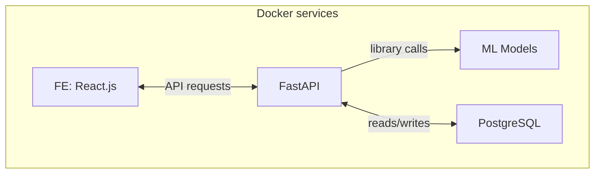

# ByeLingua
*byelingual – when you speak two languages, but start losing vocabulary in both of them*

## Członkowie zespołu
ZPRP zespół 9:

- Michał Machnikowski 325191
- Paweł Skorupski 325225
- Binh Vuong Le Duc 330097

## Repozytorium GitLab:
https://gitlab-stud.elka.pw.edu.pl/zprp-z9/byelingua

## Harmonogram
| Data       | Zakres                                                                                                                  |
| ---------- | ----------------------------------------------------------------------------------------------------------------------- |
| 23.03.2025 | Design proposal                                                                                                         |
| 30.04.2025 | Projekt bazy danych, UI design, logowanie i rejestracja – frontend i backend                                            |
| 06.04.2025 | Ładowanie plików CSV, integracja ładowania plików z aplikacji frontendowej, zapisywanie dokumentu                       |
| 13.04.2025 | Tłumaczenie tekstu – integracja z istniejącymi modelami, frontend – wyświetlanie wierszy i możliwość wprowadzania zmian |
| 20.04.2025 | **Funkcjonalny prototyp** – możliwość wyboru kolumn i wierszy do tłumaczenia                                            |
| 27.04.2024 | Interfejs użytkownika i integracja – udoskonalenie przepływu aplikacji przed wdrożeniem kolejnych funkcji               |
| 04.05.2025 | Funkcjonalność rozpoznawania języka oryginalnego                                                                        |
| 11.05.2025 | Testy integracyjne i optymalizacja procesu tłumaczenia oraz przetwarzania danych                                        |
| 18.05.2025 | Końcowe poprawki                                                                                                        |
| 25.05.2025 | Przygotowanie finalnej dokumentacji, demonstracja projektu                                                              |

## Bibliografia
- dokumentacja modelu:
    - https://huggingface.co/docs/transformers/main/en/model_doc/marian
- rozpoznawanie języka:
    - https://github.com/pemistahl/lingua-py
- dokumentacja FastAPI:
    - https://fastapi.tiangolo.com/
- dokumentacja PostgreSQL:
    - https://www.postgresql.org/docs/

## Planowana funkcjonalność
Aplikacja powinna działać w następujący sposób:
- aplikacja umożliwia tworzenie kont użytkowników (login, hasło)
- użytkownik wczytuje plik ze CSV zbiorem danych
- użytkownik może usunąć przesłane pliki
- aplikacja powinna wspierać rozbudowę o nowe formaty
- użytkownik zaznacza, które kolumny mają być tłumaczone
- użytkownik może wybrać zakres rzędów do tłumaczenia, oznaczyć indeksy/zakres rzędów ignorowanych
- użytkownik wybiera język(i) naturalne początkowe (czyli takie, dla których tekst ma być tłumaczony) oraz język końcowy (czyli taki, na który tekst ma być przetłumaczony) z listy dostępnych języków
- aplikacja pobiera modele na potrzeby tłumaczenia
- aplikacja iteracyjnie pokazuje jeden rząd z danych w następujący sposób:
    - dla każdej wybranej kolumny pokazywana jest oryginalna wartość tej kolumny, rozpoznany język tekstu oraz zaproponowane tłumaczenie w oddzielnym, edytowalnym polu tekstowym
    - jeśli język tekstu nie został rozpoznany, użytkownik zostaje o tym poinformowany
    - jeśli oryginalna wartość kolumny już jest napisana w języku docelowym to jej wartość powinna zostać przeniesiona do edytowalnego pola tekstowego
    - użytkownik może poprawić zaproponowane tłumaczenie, a następnie zaakceptować tak przetłumaczony rząd i przejść do następnego
    - mile widziane sterowanie za pomocą konfigurowalnych skrótów klawiszowych
- użytkownik może w każdym momencie przerwać proces tłumaczenia oraz ściągnąć nowy plik z przetłumaczonymi i zaakceptowanymi rzędami, przy czym rzędy nieprzetłumaczone/niezaakceptowane powinny pozostać bez zmian z zachowaniem oryginalnej kolejności
- aplikacja przechowuje aktualną postać wczytanych plików na serwerze
- aplikacja pozwala na wznowienie procesu tłumaczenia po ponownym uruchomieniu

## Planowany stack technologiczny
- Szablon (`copier`): https://github.com/fastapi/full-stack-fastapi-template
- Konteneryzacja: Docker & Docker Compose
- Database – PostgreSQL
- Backend:
    - Python 3.10
    - FastAPI
    - Swagger
    - JWT Authentication
    - SQLModel
    - Pydantic
    - Modele językowe (wstępnie):
        - MarianMT – tłumaczenie
        - lingua-py – rozpoznawanie języka
    - Zarządzanie kodem:
        - uv – zarządzanie pakietami
        - Black – formatter
        - Isort – sortowanie importów
        - Flake8 – linter
        - Mypy – statyczna analiza kodu
- Frontend:
    - Typescript
    - React v19
    - Vite
    - Chakra UI
    - Nginx
- Dokumentacja: Sphinx / mkdocs (TBD)
- Gitlab Issues – śledzenie postępu
- **CI**/CD (testy automatyczne)

## Architektura

